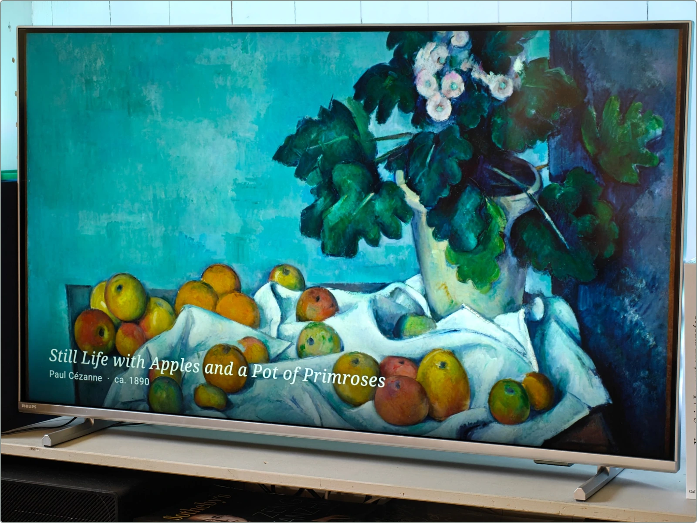

# Painting TV

A quiet, offline painting slideshow for Android TV and Google TV: 2,160 famous
paintings, no account, ads, analytics, or server. Built with Kotlin and Compose
for TV; Python tools prepare the collection.



## Install on your TV

You need the TV and a computer. It takes about 10 minutes plus the collection
download.

**1. Download the APK.** On your computer, open the
[latest release](https://github.com/Mateleo/painting-tv/releases) and download
`painting-tv-<version>.apk` (for example, `painting-tv-0.4.1.apk`). The repository is private, so the TV can't fetch it directly.

**2. Allow installing apps on the TV.**

1. **Settings → System → About**, then press OK on **Android TV OS build** seven
   times until it says you are a developer.
2. **Settings → Apps → Security & restrictions → Unknown sources** and allow the
   app you will install from (your file manager, or Send Files to TV).

Menu names vary slightly between TV brands.

**3. Copy the APK to the TV and install it.** Pick one:

- **USB stick:** copy the downloaded APK onto it, plug it into the TV, open it in
  a file manager app (e.g. *File Commander* or *X-plore* from the Play Store),
  and choose **Install**.
- **Over Wi-Fi:** install *Send Files to TV* on both your phone and the TV, send
  the APK, then open it on the TV and choose **Install**.
- **ADB** (computer on the same network): turn on **Settings → System →
  Developer options → Network debugging**, then run:

  ```sh
  adb connect TV_IP:5555        # accept the prompt on the TV
  adb install -r painting-tv-0.4.1.apk  # use the version you downloaded
  ```

**4. Download the collection.** Open **Painting TV**. On first launch, Settings
opens on **Download all · 2.9 GB**. Press OK and allow notifications if asked.
The paintings download from a public
[Hugging Face dataset](https://huggingface.co/datasets/Mateleo/painting-tv-collection)
in the background, several at a time; close Settings to keep watching
meanwhile. Downloaded paintings join the slideshow as they arrive. **Cancel**
pauses the download and keeps what is already downloaded; **Resume download**
continues it. Once every image is in, the gallery works fully offline. Keep
about 3 GB free.

**Updating:** install the APK from a newer release the same way. Settings and the
collection are kept.

## Using it

- **Left / Right:** previous / next painting.
- **OK or any direction:** show the controls (they hide after five seconds).
- **Play/Pause, Next, Previous, Menu** remote keys work too.
- **Back:** close settings or hide the controls, then exit.

Settings: time per painting (10 s to 1 h, default 30 s), slow zoom, captions,
**fill screen** or **whole painting** framing, and an **All / HD+ / 4K+** filter
by source resolution. Playback shuffles through every painting before repeating
and keeps the TV awake.

## The collection

Paintings come from the Anki deck
[Tableaux de maîtres : les 2000 plus vus](https://ankiweb.net/shared/info/171273480).
Its thumbnails were replaced by larger matching reproductions from WikiArt,
Wikimedia Commons, and museum open-access sources wherever one passed image
comparison and review. Nothing is upscaled or AI-generated. It is still mixed
resolution: 280 paintings fill a 4K screen natively, 583 fit in 4K with margins.
[catalog/quality-upgrade-report.csv](catalog/quality-upgrade-report.csv) lists
every painting's size and source. Dates are as given by the deck; titles too,
except that titles the deck gives in English are shown in French
(`app/src/main/assets/titles-fr.json`).

Rights remain with their holders. Many works are public domain; some are under
Creative Commons or still in copyright. This is a personal, non-commercial
viewer.

## Development

Requires JDK 17, Android SDK 35, and [uv](https://docs.astral.sh/uv/).

```sh
./gradlew assembleDebug testDebugUnitTest lintDebug --no-daemon
uv run --locked --extra images pytest
uv run --locked --extra images ruff check tools tests
uv run --locked --extra images ty check
```

The APK lands in `app/build/outputs/apk/debug/`. It is debug-signed; keep the
same key to install updates over an existing install. See
[tools/README.md](tools/README.md) for building and publishing the collection.

Launcher assets follow the [Android TV icon guidelines](https://developer.android.com/design/ui/tv/guides/system/tv-app-icon-guidelines):
an adaptive framed-landscape icon, a 16:9 banner with the app name, and a separate
single-color notification icon. Vector sources are in `app/src/main/res/drawable/`;
the adaptive layers are wired in `app/src/main/res/mipmap-anydpi-v26/`. PNG copies in
`mipmap-*dpi/` let file managers show an icon for the APK.

## Releases

Every release APK includes its version: `painting-tv-<version>.apk`.
After setting the app version and writing `docs/release-v<version>.md`, build and
check the app with the command above, then stage the release (example: 0.4.1):

```sh
python -m tools.prepare_release --tag v0.4.1
```

This reads Android's build metadata, checks that the APK version matches the
tag, and writes `data/release-v0.4.1/painting-tv-0.4.1.apk` and `SHA256SUMS.txt`.
Commit and push the version and notes, tag that commit, then create the release
with those two files:

```sh
git tag -a v0.4.1 -m "Painting TV 0.4.1"
git push origin v0.4.1
gh release create v0.4.1 --verify-tag --prerelease --latest \
  --title "Painting TV 0.4.1" --notes-file docs/release-v0.4.1.md \
  data/release-v0.4.1/painting-tv-0.4.1.apk data/release-v0.4.1/SHA256SUMS.txt
```

Use the same local signing key as earlier releases so installed apps can update.
